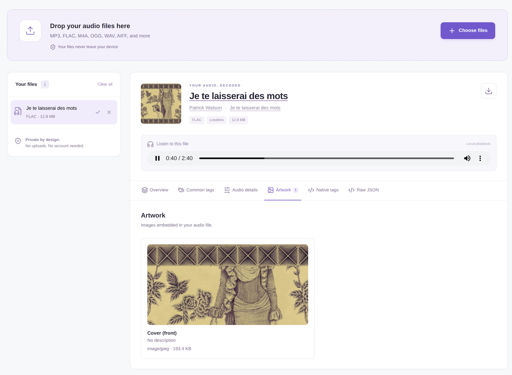

# Audio Tag Analyzer

**[Open the live Audio Tag Analyzer](https://audio-tag-analyzer.netlify.app/)**

Audio Tag Analyzer demonstrates the capabilities of [music-metadata](https://github.com/Borewit/music-metadata). It lets you view the metadata stored in your audio files, including song titles, artists, albums, cover art, and audio format details.

Everything runs in your browser. Your files stay on your device and are never uploaded anywhere. No account is needed.



## How to use it

1. [Open the live app](https://audio-tag-analyzer.netlify.app/).
2. Select audio files or drag and drop them anywhere on the page.
3. Choose a file to explore its metadata and cover art.

You can search metadata by name or value, follow [MusicBrainz](https://musicbrainz.org/) links when available, and download the metadata as a JSON file. You can also listen to files supported by your browser.

The Media details tab shows audio properties, complete media duration and overall file bitrate when available, and individual tracks with their IDs, names, codecs, languages, enabled/default/forced flags, timing, and audio or video properties. Supported formats include MP3, FLAC, M4A, Ogg, WAV, AIFF, and CAF (Apple Core Audio Format). The header artwork uses the front cover when one is available.

## Run locally

Requires Node.js 22.12 or newer.

```sh
npm ci
npm run dev
```

## License

This project is licensed under the [MIT License](LICENSE). Feel free to use, modify, and distribute as needed.
